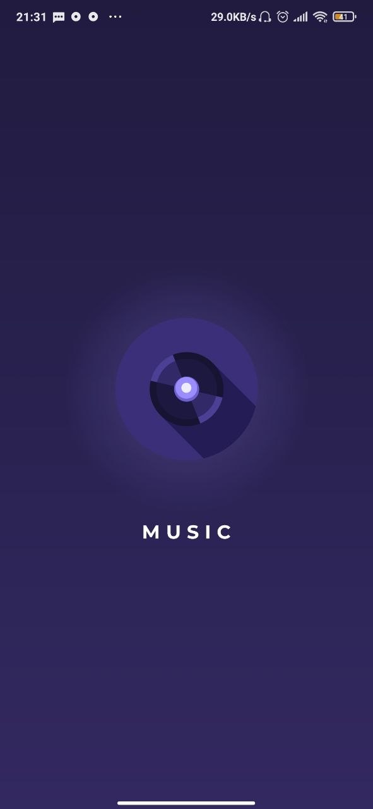
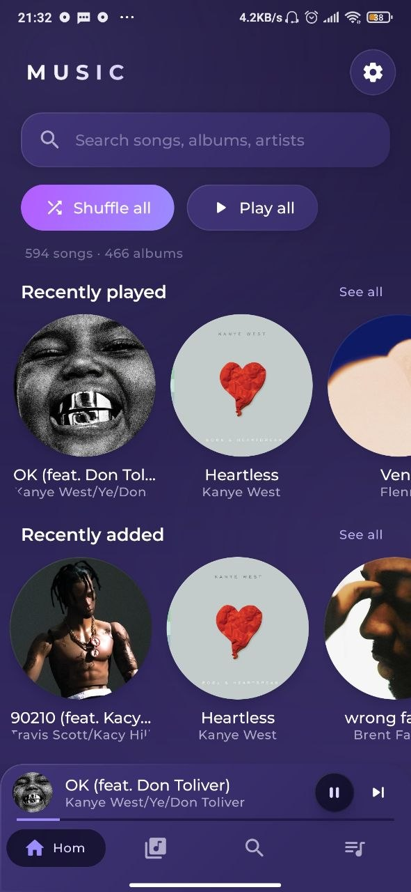
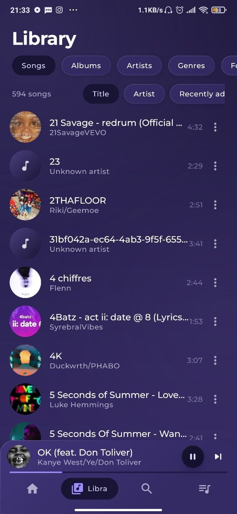
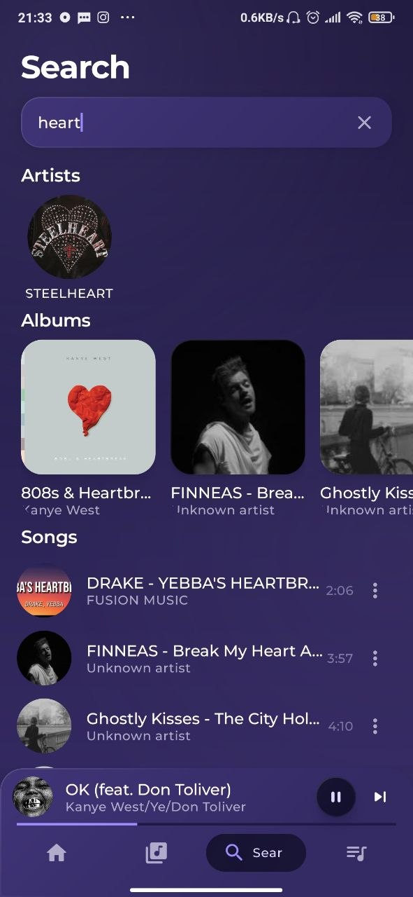
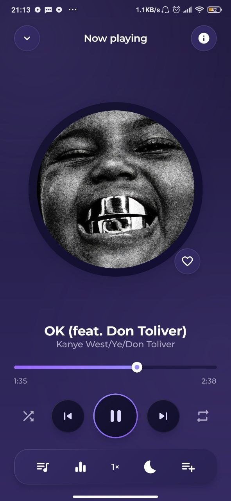
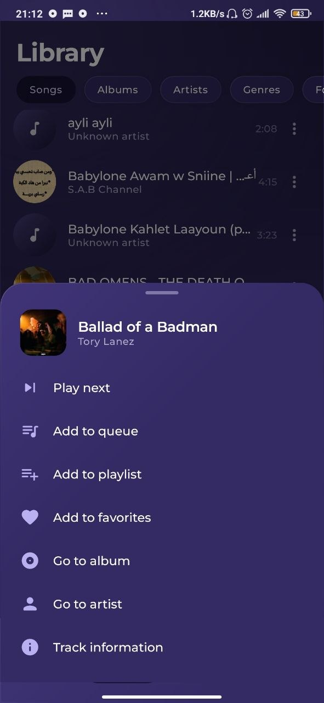
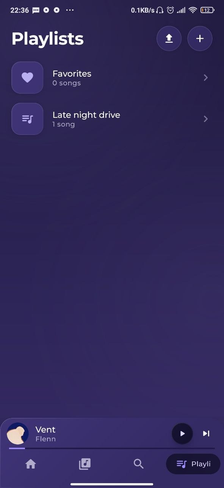
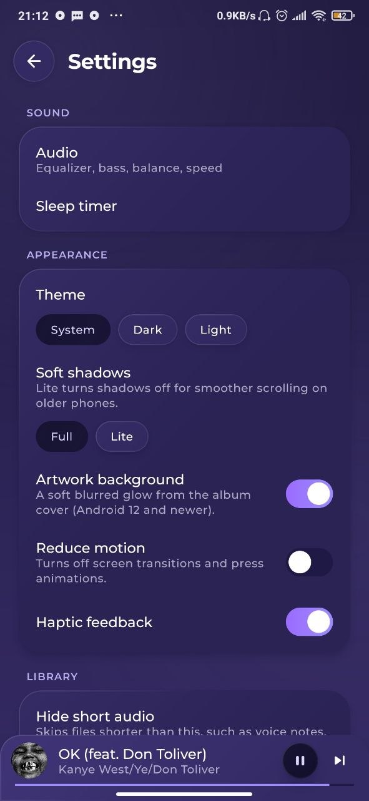
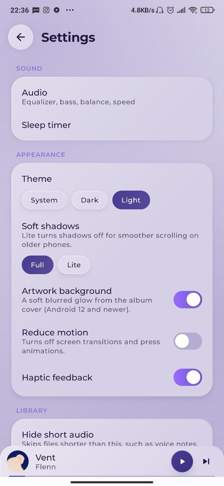

<p align="center">
  
</p>

<h1 align="center">Music</h1>

<p align="center">
  Your music. Your control.<br>
  A fast, private, fully offline music player for Android. It plays the songs already on your phone.
  No accounts, no ads, no tracking, no internet permission.
</p>

<p align="center">
  
  
  
  
  
</p>

---

## Screenshots

<table>
  <tr>
    <td align="center"><br><sub>LaunchScreen</sub></td>
    <td align="center"><br><sub>Home</sub></td>
    <td align="center"><br><sub>Library</sub></td>
  </tr>
  <tr>
    <td align="center"><br><sub>Search</sub></td>
    <td align="center"><br><sub>Player</sub></td>
    <td align="center"><br><sub>Song</sub></td>
  </tr>
  <tr>
    <td align="center"><br><sub>Playlists</sub></td>
    <td align="center"><br><sub>Settings-Dark Mode</sub></td>
    <td align="center"><br><sub>Settings-Light Mode</sub></td>
  </tr>
</table>

## Features

- **Your own library.** Finds the music on your phone and SD card, or any folder you pick. Songs, albums, artists, genres and a folder browser.
- **Smart lists you control.** Favorites, recently added, recently played and most played. Nothing is recommended or pushed at you.
- **Real playback.** Gapless playback, shuffle, repeat, speed control and seeking. It never starts playing on its own.
- **Queue.** Play next, add to queue, drag to reorder, remove. Your last queue comes back paused when you reopen the app.
- **Playlists.** Saved on your phone, with M3U / M3U8 import and export.
- **Sound controls.** Equalizer with 13 presets and your own presets, bass enhancement, loudness boost and left/right balance.
- **Sleep timer** (minutes or end of the current song) and an optional **fade between songs**.
- **Background playback.** Notification, lock-screen and Bluetooth controls, audio focus, and pause when headphones are unplugged.
- **Search** across songs, albums and artists.
- **Light and dark themes.** Soft violet design with round buttons and circular artwork. Reduced-motion and haptics options.
- **Private by design.** No internet permission at all. Playlists and settings stay on your phone.
- **Ready for Arabic.** Texts live in resources and the layout supports right-to-left.

## Tech stack

| Part | Choice |
|---|---|
| Language | Kotlin |
| UI | Jetpack Compose |
| Playback | AndroidX Media3 (ExoPlayer and MediaSession) |
| Library | Android MediaStore and the Storage Access Framework |
| Saved data | Small JSON files with safe atomic writes (no database) |
| Sound effects | Android Equalizer, BassBoost and LoudnessEnhancer |
| Font | Montserrat (SIL Open Font License) |

No backend, no Firebase, no analytics and no paid services. Everything is free to build and run.

## Quick start

You need [Android Studio](https://developer.android.com/studio) (Koala 2024.1.2 or newer) and an Android 8.0+ phone or emulator.

1. **Get the code**
   ```bash
   git clone https://github.com/goucem-meriem-malak/music-player.git
   cd music-player
   ```
2. Open the folder in Android Studio and wait for **Gradle sync** (internet is needed only this first time).
3. Plug in your phone and press **Run**.
4. On first launch, allow **Music and audio** access and **Notifications**. You can also add a folder instead of giving music access.

Build an APK to install on your phone:

```bash
./gradlew assembleRelease
```

The APK is created in `app/build/outputs/apk/release/`. More detail and common errors are in [SETUP.md](SETUP.md).

## Project structure

```
app/src/main/java/com/gmm/music/
  MusicApp.kt          app start and shared objects
  MainActivity.kt      the one screen host
  data/                library scan, playlists, favorites, settings, JSON storage
  playback/            background service, player connection, sleep timer
  audio/               equalizer, bass, loudness, balance
  ui/                  navigation, screens, components, theme
  util/                artwork loading and formatting
docs/                  logo, screenshots, privacy notice, documentation
```

## Status

Built and tried by hand on one Android phone. Unit tests are included in `app/src/test` but have not been run yet.
Known limits are listed in [DOCUMENTATION.md](DOCUMENTATION.md).

## License

All rights reserved. See [LICENSE](LICENSE).

## Credits

Built with AndroidX Jetpack Compose and Media3, Kotlin, kotlinx.coroutines and Guava (Apache License 2.0).
The Montserrat font is licensed under the SIL Open Font License 1.1.
